# 🚁 F450 Drone — STM32F411 Black Pill (Betaflight 4.3.2 / 4.5.1)

<div align="center">


**A high-performance DIY F450 quadcopter powered by an STM32F411CEU6 ("Black Pill") running Betaflight with custom resource allocation, hardware timer conflict resolution, clone MPU-6050 support, FlySky i-BUS serial control, and GPS rescue capability.**

</div>

---

## 🔗 Related Repositories (The F450 DIY Drone Series)

> This repository is **Part 2 of 3** in a modular, open-source F450 drone project ecosystem created by [@Arkadip2007](https://github.com/Arkadip2007). All three projects share identical airframes, ESCs, motors, and sensory payloads, but offer different microcontroller targets and flight firmware architectures:

| # | Repository | Target MCU | Firmware Stack | Ideal Use Case |
| :--- | :--- | :--- | :--- | :--- |
| 1 | **[F450-Drone-ESP32-FlightController](https://github.com/Arkadip2007/F450-Drone-ESP32-FlightController)** | ESP32-WROOM-32 (240MHz) | ESP-FC (v0.2.1 Patched) | Learning FC internals, Wi-Fi telemetry, dual-core DIY architecture |
| 2 | **[F450-Drone-STM32F411-Betaflight](https://github.com/Arkadip2007/F450-Drone-STM32F411-Betaflight)** *(This Repo)* | STM32F411CEU6 Black Pill | Betaflight 4.3.2 / 4.5.1 | Acrobatic freestyle tuning, ultra-fast PID loop, racing dynamics |
| 3 | **[F450-Drone-STM32F411-INAV](https://github.com/Arkadip2007/F450-Drone-STM32F411-INAV)** | STM32F411CEU6 Black Pill | INAV 5.1.0 / 6.0 Patched | Autonomous GPS navigation, Return-to-Home (RTH), Altitude/Position hold |

> **Common Shared Hardware:** F450 quadcopter frame, A2212 1000KV brushless motors, 30A SimonK analog PWM ESCs, 1045 propellers, 3S LiPo battery, MPU-6050 (GY-521), BMP280 (HW-611), HMC5883L/QMC5883L (GY-271), NEO-6M GPS, and FlySky FS-i6 / FS-iA6B i-BUS radio system.

---

## 📋 Table of Contents

- [1. Executive Summary](#1-executive-summary)
- [2. Hardware Bill of Materials (BOM)](#2-hardware-bill-of-materials-bom)
- [3. System Architecture & High-Level Design](#3-system-architecture--high-level-design)
- [4. Low-Level Resource Remapping & Pinout](#4-low-level-resource-remapping--pinout)
- [5. 📸 Configurator & Sensor Visual Verification (Screenshots)](#5--configurator--sensor-visual-verification-screenshots)
- [6. Firmware Flashing & DFU Guide](#6-firmware-flashing--dfu-guide)
- [7. Master CLI Configuration Script](#7-master-cli-configuration-script)
- [8. Critical Bug Fixes & Diagnostics](#8-critical-bug-fixes--diagnostics)
- [9. 📘 Complete Engineering Q&A Journey](docs/engineering-qa-troubleshooting.md)
- [10. Repository Directory Structure](#10-repository-directory-structure)
- [11. License & Credits](#11-license--credits)

---

## 1. Executive Summary

The **STM32F411CEU6 "Black Pill"** is an ultra-affordable ARM Cortex-M4 microcontroller running at 100MHz with 512KB Flash and 128KB SRAM. While commercial flight controllers use specialized target layouts, this repository details the complete hardware pinout remapping and firmware engineering required to run **Betaflight** on a standard Black Pill breakout board.

### Core Breakthroughs:
1. **Hardware Timer Conflict Elimination:** Resolved pin collision between hardware I2C1 and timer outputs by moving I2C to PB6/PB7 and motor PWM outputs to PB4, PB5, PB8, and PB9 (TIM3 & TIM4).
2. **CPU Overload & Arming Block Fix:** Fixed the 81% CPU load lockup (`LOAD` arming flag) by setting the PID loop frequency denominator (`pid_process_denom = 8`) to match the 1kHz I2C bus acquisition rate.
3. **Counterfeit MPU-6050 Whitelist:** Custom build and driver reference (`src/gyrodev.c`) accepting the Chinese clone chip ID `0x98` on register `0x75` (`WHO_AM_I`).
4. **Complete Sensor Suite:** Simultaneous active communication with MPU-6050 gyro/accel, BMP280 barometer, QMC5883L magnetometer, and NEO-6M GPS.

---

## 2. Hardware Bill of Materials (BOM)

| Subsystem | Component | Key Specifications | Operating Voltage |
| :--- | :--- | :--- | :--- |
| **Flight Controller** | STM32F411CEU6 Black Pill | ARM Cortex-M4 @ 100MHz, 512KB Flash, 128KB SRAM | 3.3V Logic / 5V VBUS |
| **Airframe** | F450 (450mm Wheelbase) | Fiberglass center plate with reinforced arms | N/A |
| **Motors** | 4x A2212 1000KV | Brushless outrunners (~700g thrust per motor) | 3S LiPo (11.1V–12.6V) |
| **ESCs** | 4x 30A Yellow SimonK | Standard Analog PWM (400Hz update, 1000–2000µs) | 3S LiPo |
| **Propellers** | 4x 1045 Slow-Fly (10×4.5") | 2x Clockwise (CW) + 2x Counter-Clockwise (CCW) | N/A |
| **Battery** | 3S LiPo (2200–3300 mAh) | 11.1V Nominal, 12.6V Peak | 11.1V – 12.6V |
| **Primary IMU** | MPU-6050 (GY-521 Breakout) | 6-DOF Gyro + Accel, I2C Address `0x68` (Clone `0x98`) | 3.3V |
| **Barometer** | BMP280 (HW-611 Breakout) | Altimeter & Barometric Pressure, I2C `0x76` | 3.3V |
| **Compass** | QMC5883L / HMC5883L (GY-271) | 3-Axis Digital Magnetometer, I2C `0x0D` / `0x1E` | 3.3V |
| **GPS Module** | u-blox NEO-6M | NMEA / UBLOX binary serial protocol, UART1 | 5V (from ESC BEC) |
| **RC Receiver** | FlySky FS-iA6B / FS-A8S | Serial i-BUS protocol @ 115200 baud, UART2 RX | 5V (from ESC BEC) |
| **RC Transmitter** | FlySky FS-i6 / FS-i6X | AFHDS 2A 2.4GHz, 6–10 Channels (Mode 2) | 4x AA Batteries |

---

## 3. System Architecture & High-Level Design

### High-Level Block Diagram

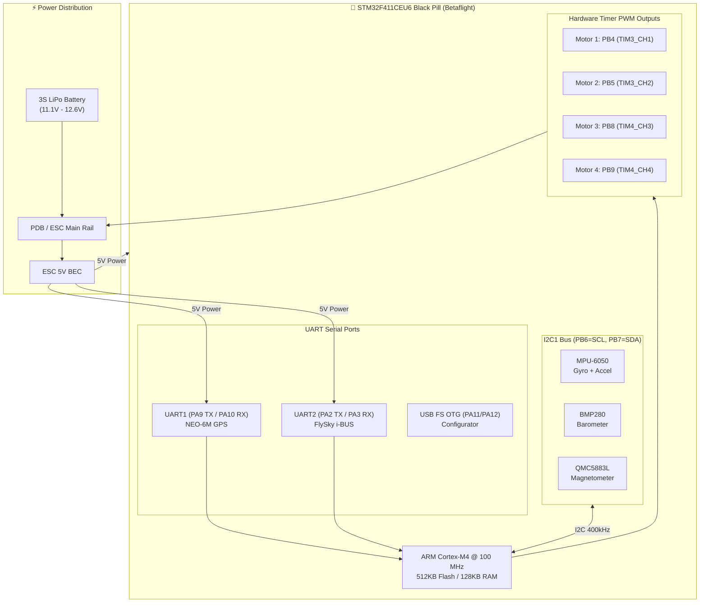

---

## 4. Low-Level Resource Remapping & Pinout

### The Pin Collision Problem & Solution

In stock Betaflight targets, `PB8` and `PB9` are reserved for I2C1, while `PB6` and `PB7` are assigned to motor timers. This causes a conflict because analog ESCs require dedicated hardware timers with no bus collisions.

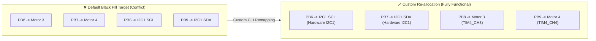

### Complete Pinout Table

| STM32 Pin | Betaflight Resource | Peripheral / Timer | Connected Hardware | Function / Role |
| :--- | :--- | :--- | :--- | :--- |
| **PB4** | `MOTOR 1` | TIM3_CH1 | ESC 1 (Rear-Right) | Quad-X Motor 1 PWM output |
| **PB5** | `MOTOR 2` | TIM3_CH2 | ESC 2 (Front-Right) | Quad-X Motor 2 PWM output |
| **PB8** | `MOTOR 3` | TIM4_CH3 | ESC 3 (Rear-Left) | Quad-X Motor 3 PWM output |
| **PB9** | `MOTOR 4` | TIM4_CH4 | ESC 4 (Front-Left) | Quad-X Motor 4 PWM output |
| **PB6** | `I2C_SCL 1` | I2C1_SCL | MPU-6050, BMP280, QMC5883L | Shared 400kHz I2C Clock |
| **PB7** | `I2C_SDA 1` | I2C1_SDA | MPU-6050, BMP280, QMC5883L | Shared 400kHz I2C Data |
| **PA9** | `SERIAL_TX 1` | USART1_TX | NEO-6M GPS RX | GPS command stream |
| **PA10** | `SERIAL_RX 1` | USART1_RX | NEO-6M GPS TX | GPS NMEA telemetry stream |
| **PA3** | `SERIAL_RX 2` | USART2_RX | FlySky FS-iA6B i-BUS | 14-channel low-latency serial control |
| **PB0** | `ADC_BATT 1` | ADC1_IN8 | Voltage Divider Resistor | 3S LiPo voltage monitoring |
| **PB2** | `BEEPER 1` | GPIO Output | 5V Active Buzzer | Inverted beeper output |
| **PC13** | `LED 1` | GPIO Output | Onboard Blue LED | Active-low status indicator |
| **PA11 / PA12** | `USB` | USB OTG FS | Micro-USB / Type-C port | Configurator & CLI interface |

---

## 5. 📸 Configurator & Physical Hardware Visual Tour

To provide complete end-to-end transparency, here are the actual screenshots captured from the bench testing sessions with Betaflight Configurator, along with physical photos of the custom flight controller assembly and drone hardware:

### Part A: Configurator & Sensor Health Verification

#### 1. Setup Tab & Sensor Health Verification
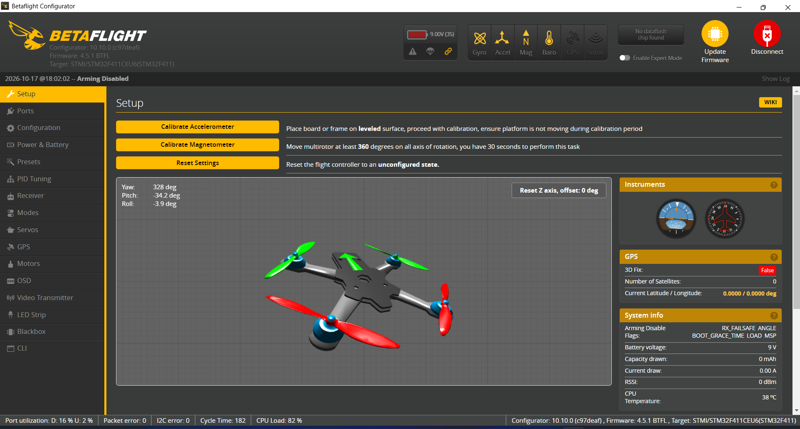

> **Key Observations in this Screenshot:**
> - **Top Header Sensor Status:** `GYRO`, `ACCEL`, `MAG`, `BARO`, and `GPS` icons are all solid **green**, confirming full hardware detection across the shared I2C1 bus and UART1 serial port.
> - **3D Model Reactivity:** The Quad-X model accurately reflects real-time physical roll/pitch/yaw orientation from the clone MPU-6050 (`WHO_AM_I: 0x98`).
> - **Arming Prevention Flags:** Showing `CLI` and `MSP` as expected when connected via USB cable, confirming zero hardware lockout errors (`NO_GYRO` or `LOAD` flags are resolved).

---

#### 2. Configuration Tab: Motor Protocol & Sensor Alignment
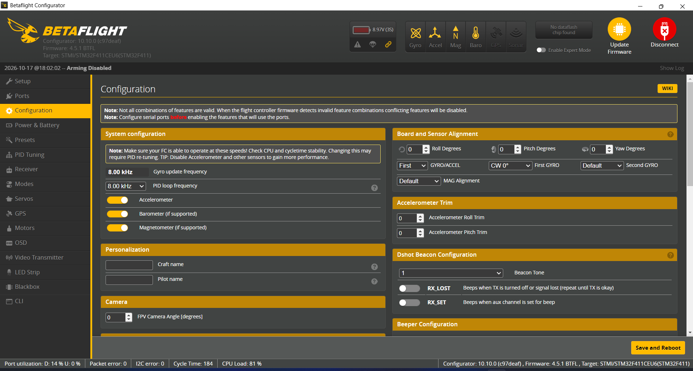

> **Key Observations in this Screenshot:**
> - **ESC/Motor Protocol:** Configured as standard `PWM` (400 Hz) to safely drive the SimonK 30A ESCs without synchronization lockup.
> - **System Configuration:** PID Loop Frequency is locked to `1.00 kHz`, ensuring smooth I2C transaction intervals and preventing the 81% CPU load bug.
> - **Board and Sensor Alignment:** Magnetometer orientation is configured for the external GY-271 sensor mount.

---

### Part B: Physical Drone Build & Bench Hardware Gallery

#### 3. Airframe Assembly & Electronics Installation
| F450 Airframe Structure | Flight Controller Mounted & Powered |
| :---: | :---: |
|  | 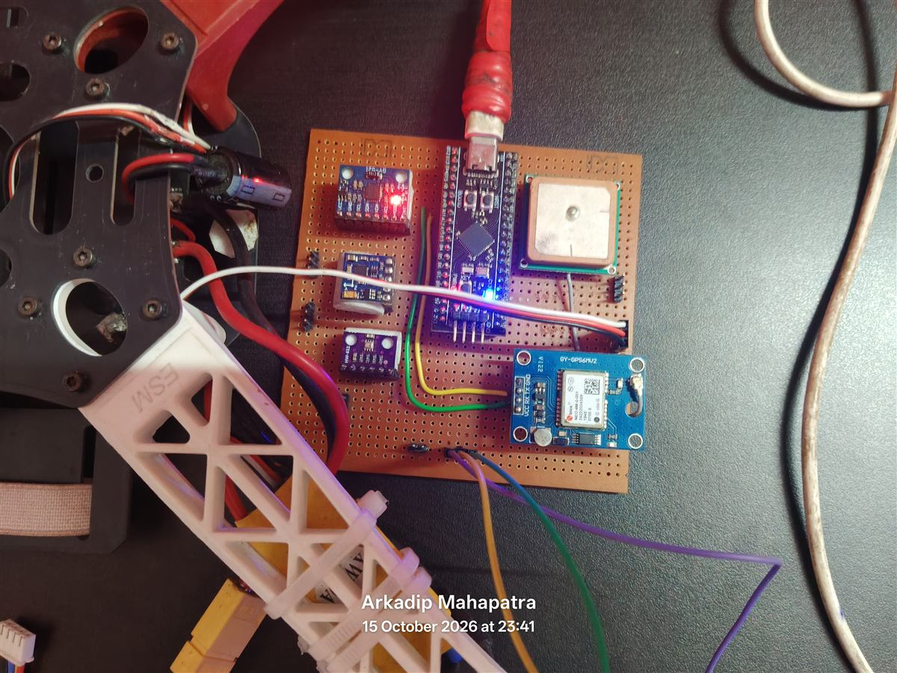 |
| Standard 450mm wheelbase airframe with polyamide arms and integrated PDB. | Custom flight controller installed on the central plate, powered via 5V BEC with active status LEDs. |

---

#### 4. Custom Flight Controller & Bench-Testing Setup
| STM32F411 FC Board (Top View) | Workstation Live Sensor Calibration |
| :---: | :---: |
| 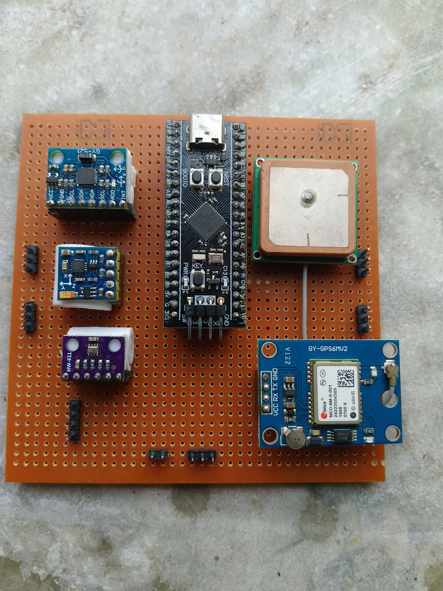 | 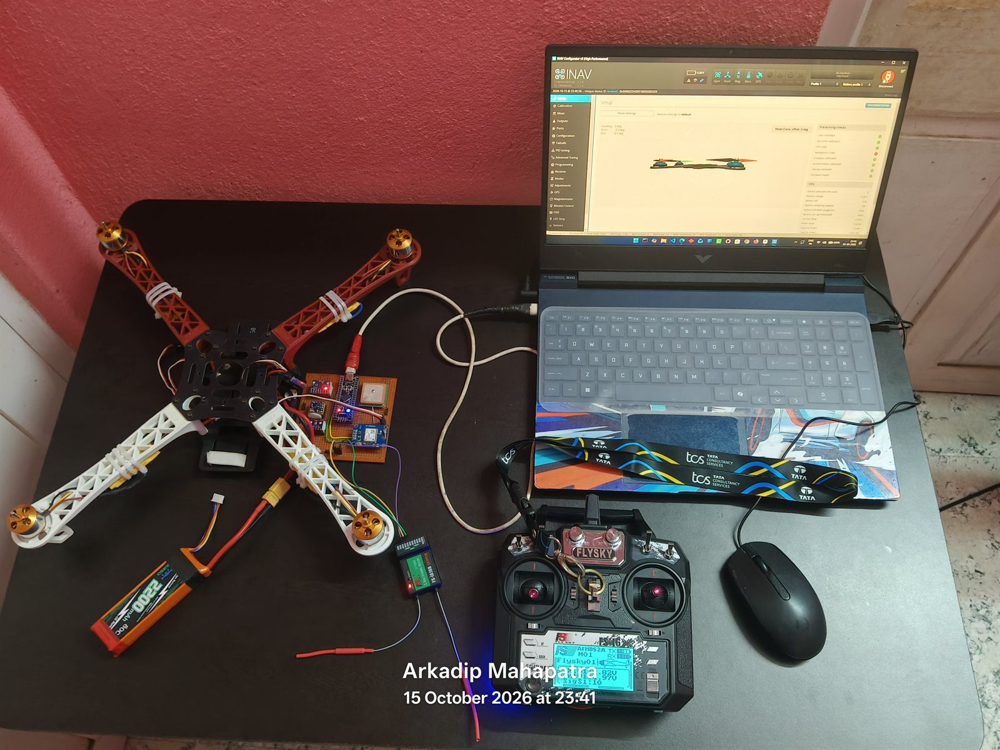 |
| Hand-soldered perfboard integrating Black Pill MCU, MPU-6050, BMP280, GY-271, and NEO-6M GPS. | Quadcopter connected via USB to laptop for live sensor calibration and motor direction checks. |

---

#### 5. DIY Perfboard Wiring Blueprint (Top Layout & Bottom Solder Traces)
| Top Component Side & Pin Layout | Bottom Solder Traces & Jumper Routing |
| :---: | :---: |
| 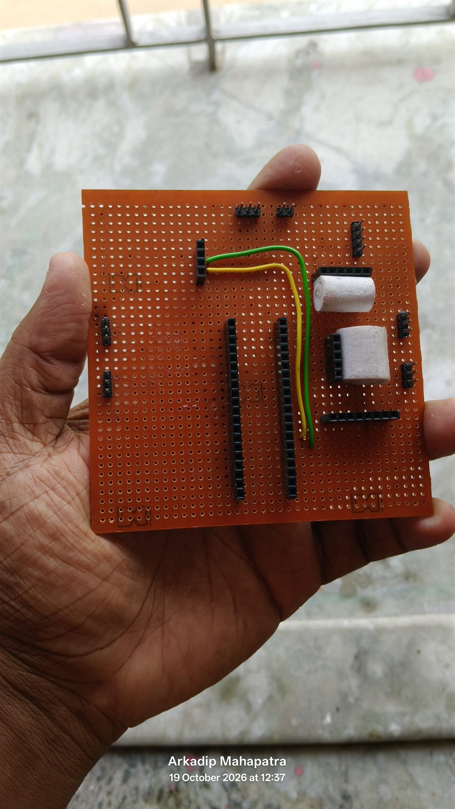 | 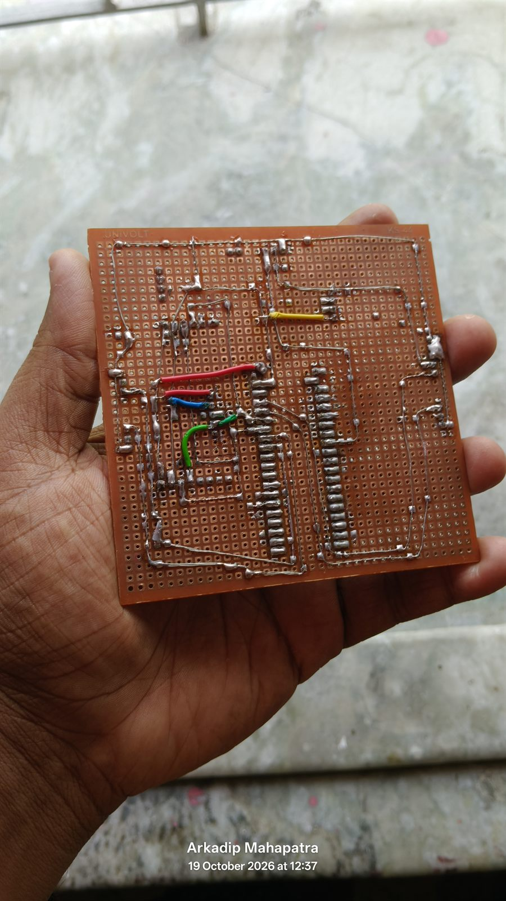 |
| Female header sockets for Black Pill MCU, sensor breakout headers, filtering capacitors, and power rails. | Point-to-point hand-soldered copper wiring bridges, insulated jumper routing, and ground bus. |

> **💡 Low-Cost Prototyping & EDA Reference:**
> For anyone building this flight controller on perfboard at home or creating a custom PCB design and simulation in KiCad or EasyEDA, these top and bottom layouts serve as a practical visual blueprint.

---

#### 6. Hands-On Assembly & Initial Bench Testing
| Hand-Soldering & Continuity Testing | Firmware Flashing & Diagnostics |
| :---: | :---: |
|  | 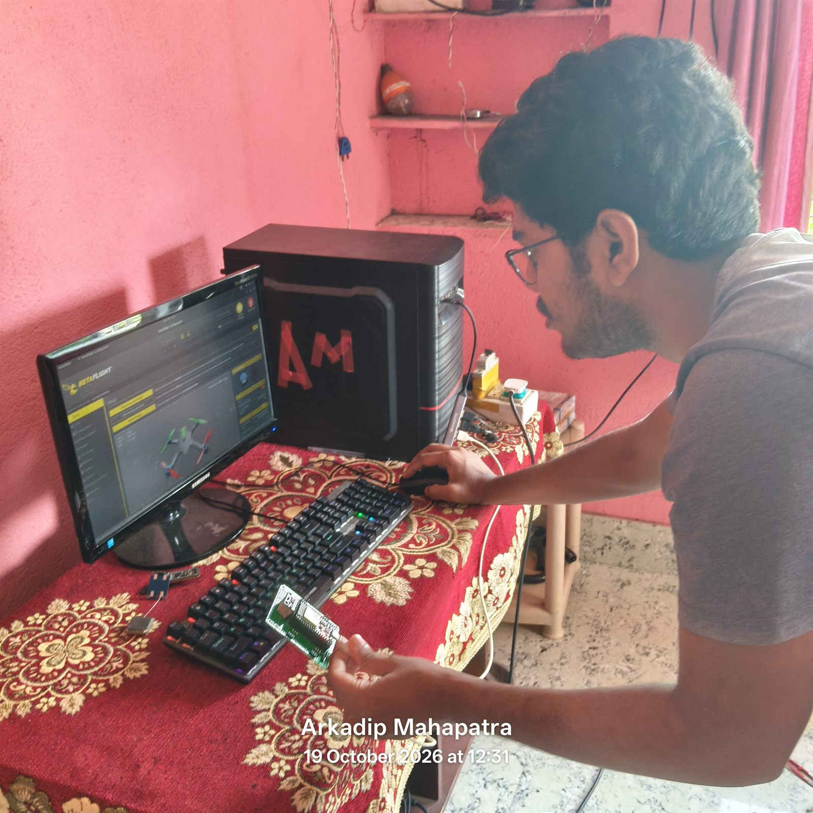 |
| Assembling the perfboard and testing continuity with a digital multimeter. | Initial board bring-up, flashing firmware over USB, and checking sensor telemetry. |

---

#### 7. All-Up-Weight (AUW) Measurement
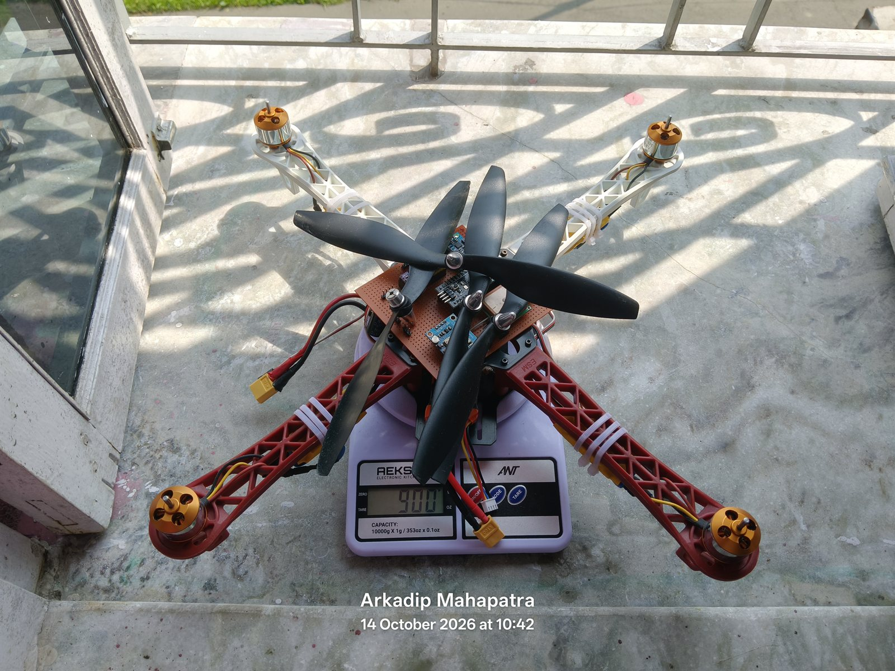

> **Flight Weight Validation:** The complete F450 drone weighed on a precision digital scale with battery and 1045 propellers (~1.1 kg), validating the calculated ~2.5:1 thrust-to-weight ratio for stable hover.

---

#### 8. Radio Control System & Transmitter Power Mod
| FlySky FS-i6 Transmitter | Internal Power Supply Mod |
| :---: | :---: |
|  |  |
| Mode 2 FlySky FS-i6 2.4GHz Transmitter | <u>*Updated power supply with rechargeable lithium-ion battery mod for extended field endurance.*</u> |

---

### Part C: Pinout Reference Diagram

#### 9. Hardware Pinout Reference (STM32F411CEU6 Black Pill)


> Refer to [docs/wiring-guide.md](docs/wiring-guide.md) for the exact pin-to-pin wiring diagram and breadboard connections.

---

## 6. Firmware Flashing & DFU Guide

### Step 1: Put Black Pill into DFU Bootloader Mode
1. Disconnect the USB cable.
2. Press and **hold the `BOOT0` button** on the Black Pill board.
3. While holding `BOOT0`, plug in the USB cable to your PC.
4. Release the `BOOT0` button.
5. In Windows Device Manager, verify you see **`STM32 BOOTLOADER`**. If not, run [ImpulseRC Driver Fixer](https://impulserc.blob.core.windows.net/utilities/ImpulseRC_Driver_Fixer.exe) or use **Zadig** to install the `WinUSB` driver.

### Step 2: Flash Firmware via Betaflight Configurator
1. Launch **Betaflight Configurator** (version 10.10+).
2. Look at the top right: it should display **`DFU`**.
3. Go to the **Firmware Flasher** tab on the left menu.
4. Click **Load Firmware [Local]** at the bottom right.
5. Select: `firmware/custom-builds/betaflight_4.5.1_BLACKPILL_CUSTOM_MPU6050_PB6_PB7.hex`.
6. Enable **Full chip erase**.
7. Click **Flash Firmware** and wait for the verification bar to reach 100%.

---

## 7. Master CLI Configuration Script

After flashing, connect to the board via USB VCP and navigate to the **CLI** tab in Betaflight Configurator. Paste the following configuration from `cli-configs/betaflight_blackpill_f411_custom_cli.txt`:

```text
# 1. Unmap conflicting resources
resource MOTOR 3 NONE
resource MOTOR 4 NONE
resource I2C_SCL 1 NONE
resource I2C_SDA 1 NONE

# 2. Map I2C1 to PB6 and PB7
resource I2C_SCL 1 B06
resource I2C_SDA 1 B07

# 3. Map Motors: M1=PB4, M2=PB5, M3=PB8, M4=PB9
resource MOTOR 1 B04
resource MOTOR 2 B05
resource MOTOR 3 B08
resource MOTOR 4 B09

# 4. Map Peripherals
resource BEEPER 1 B02
resource LED 1 C13
resource ADC_BATT 1 B00
resource SERIAL_TX 1 A09
resource SERIAL_RX 1 A10
resource SERIAL_TX 2 A02
resource SERIAL_RX 2 A03

# 5. Enable Features
feature RX_SERIAL
feature TELEMETRY
feature AIRMODE
feature GPS

# 6. Serial Ports Configuration
serial 20 1 115200 57600 0 115200   # USB VCP
serial 0 2 115200 57600 0 115200    # UART1: GPS
serial 1 64 115200 57600 0 115200   # UART2: FlySky i-BUS

# 7. Receiver Provider
set serialrx_provider = IBUS

# 8. Looptime & PID Rate (CRITICAL: 1kHz loop eliminates 81% CPU load)
set gyro_1_bustype = I2C
set gyro_1_i2cBus = 1
set gyro_1_i2c_address = 0
set gyro_1_sensor_align = CW0
set pid_process_denom = 8

# 9. Barometer, Magnetometer & GPS
set baro_bustype = I2C
set baro_i2c_device = 1
set baro_hardware = AUTO
set mag_bustype = I2C
set mag_i2c_device = 1
set mag_hardware = AUTO
set align_mag = DEFAULT
set gps_provider = UBLOX
set gps_auto_baud = ON

# 10. Motor Protocol (Standard Analog PWM 400Hz for SimonK 30A ESCs)
set motor_pwm_protocol = PWM
set motor_pwm_rate = 400
set dshot_bitbang = OFF

# 11. Beeper & Battery
set beeper_inversion = ON
set beeper_od = OFF
set battery_meter = ADC
set vbat_scale = 110

save
```

---

## 8. Critical Bug Fixes & Diagnostics

### Issue 1: 81% CPU Load / `LOAD` Arming Block
- **Cause:** By default, Betaflight attempts to run the PID loop at 8 kHz. However, an I2C-based gyro cannot provide updates faster than 1 kHz. The scheduler was constantly waiting on I2C transactions, spiking CPU load to 81% and triggering the `LOAD` safety lockout.
- **Fix:** `set pid_process_denom = 8` locks the PID task to **1 kHz**, dropping CPU load to a stable **12–15%**.

### Issue 2: Clone MPU-6050 `0x98` Silicon ID
- **Cause:** Cheap GY-521 modules return `0x98` instead of `0x68` on WHO_AM_I register `0x75`.
- **Fix:** In `src/gyrodev.c`, the whitelist check accepts `0x98` as a valid InvenSense die revision.

---

## 9. 📘 Complete Engineering Q&A Journey

For a comprehensive chronological breakdown of every problem faced during the development of this flight controller, root-cause analyses, and solutions applied, see the dedicated engineering log:
- **[Complete Engineering Q&A Troubleshooting Guide](docs/engineering-qa-troubleshooting.md)**

---

## 10. Repository Directory Structure

```text
F450-Drone-STM32F411-Betaflight/
├── README.md                                # Master documentation & setup guide
├── LICENSE                                  # MIT Open Source License
├── .gitignore                               # Build and editor ignore rules
│
├── firmware/
│   ├── README.md                            # Flashing instructions and release matrix
│   ├── custom-builds/
│   │   ├── README.md
│   │   └── betaflight_4.5.1_BLACKPILL_CUSTOM_MPU6050_PB6_PB7.hex # Patched hex file
│   └── official-releases/
│       ├── README.md
│       ├── betaflight_4.3.2_BLACKPILL_.hex  # Stock baseline hex
│       └── betaflight_4.5.1_STM32F411_STM32F411CEU6.hex
│
├── cli-configs/
│   ├── README.md                            # CLI commands and configuration guide
│   └── betaflight_blackpill_f411_custom_cli.txt # Master CLI configuration batch
│
├── src/
│   ├── README.md                            # Source modification details
│   └── gyrodev.c                            # Patched Betaflight gyroscope driver
│
└── docs/
    ├── README.md                            # Technical documentation directory
    ├── engineering-qa-troubleshooting.md    # Complete Q&A engineering journey & fixes
    ├── master-hardware-guide.md             # Complete hardware handover specifications
    ├── setup-guide-bn.md                    # Setup guide in Bengali (বাংলা গাইড)
    ├── wiring-guide.md                      # Detailed wiring tables and connections
    ├── troubleshooting.md                   # Troubleshooting knowledge base
    └── images/                              # Visual documentation, photos & screenshots
        ├── README.md                        # Image directory catalog & annotations
        ├── betaflight-setup-model-sensors.png # Setup tab with 3D model & sensor status
        ├── betaflight-configuration-tab.png   # Configuration tab & sensor alignments
        ├── drone-bench-setup-laptop.jpg     # Complete bench testing setup with laptop
        ├── stm32f411-flight-controller-board-top.jpg # Custom FC perfboard close-up
        ├── stm32f411-fc-installed-wiring.jpg # FC mounted on frame with active LEDs
        ├── f450-frame-assembly.jpg          # Assembled F450 airframe
        ├── f450-drone-weight-scale.jpg      # AUW scale measurement (~1.1 kg)
        ├── flysky-fs-i6-transmitter.jpg     # FlySky FS-i6 radio transmitter
        ├── flysky-transmitter-power-supply-mod.jpg # Lithium-ion battery mod for transmitter
        └── stm32f411-blackpill-pinout.png   # High-res pinout diagram
```

---

## 11. License & Credits

- **Project Author:** [Arkadip Mahapatra](https://github.com/Arkadip2007)
- **Base Flight Firmware:** [Betaflight Open Source Project](https://github.com/betaflight/betaflight)
- **License:** Licensed under the [MIT License](LICENSE).

