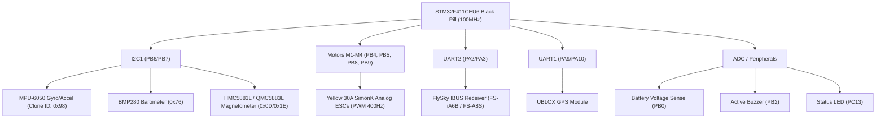

# STM32F411CEU6 (Black Pill) DIY Quadcopter Project - Master Handover & Archive Document

> **Project Title:** Custom Autonomous/Acro Quadcopter Flight Controller based on STM32F411CEU6 (Black Pill) running Betaflight 4.5.1  
> **Author & Project Owner:** Arka & Antigravity AI Pair Programming Session  
> **Date:** October 2026  
> **Status:** Fully Solved, Tested & Verified (All sensors, receiver, and PWM motor timers active)

---

## 1. Executive Summary & Purpose of this Document
This document is an exhaustive, standalone technical record of the DIY Drone Flight Controller project built using an **STM32F411CEU6 "Black Pill"** microcontroller board.

It captures every hardware component, custom pinout allocation, reverse-engineered firmware patch, root cause analysis of system crashes, and complete configuration scripts developed in this session. Any human engineer or AI model reading this document will have **100% of the context required to understand, reproduce, modify, or troubleshoot this system** without repeating earlier debugging cycles.



---

## 2. Hardware Inventory & Component Specifications

| Component | Model / Type | Operating Voltage | Interface / Protocol | Notes & Crucial Specifics |
| :--- | :--- | :--- | :--- | :--- |
| **Microcontroller (FC)** | STM32F411CEU6 (Black Pill) | 3.3V (VBUS / 5V input) | ARM Cortex-M4 @ 100MHz | 512KB Flash, 128KB SRAM. Uses external 25MHz HSE crystal. |
| **IMU (Gyro + Accel)** | MPU-6050 (Clone Variant) | 3.3V | I2C (Address `0x68`) | **Clone alert:** Returns `0x98` on register `0x75` (`WHO_AM_I`) instead of genuine InvenSense `0x68`. Requires patched firmware. |
| **Barometer** | BMP280 | 3.3V | I2C (Address `0x76`) | Auto-detected by Betaflight for altitude hold. |
| **Magnetometer (Compass)** | HMC5883L / QMC5883L | 3.3V | I2C (Address `0x0D`/`0x1E`) | Auto-detected. Requires 3D calibration in Betaflight Setup tab. |
| **Receiver (RX)** | FlySky FS-iA6B / FS-A8S | 5V | UART2 RX (IBUS Protocol) | High-speed single-wire bidirectional serial stream. |
| **ESCs** | Yellow 30A (SimonK / Generic) | 2S-3S LiPo | Standard Analog PWM (400Hz) | Non-DShot ESCs. Require hardware timer PWM pulses (1000–2000µs). |
| **Motors** | 4x Brushless (e.g., A2212 1000KV/1400KV) | 3S LiPo (11.1V–12.6V) | 3-Phase AC from ESC | Quad X configuration. |
| **GPS** | UBLOX NEO-6M / NEO-M8N | 5V | UART1 (115200 baud) | NMEA / UBLOX binary protocol for GPS telemetry & rescue. |
| **Beeper / Buzzer** | Active 5V Buzzer | 5V (Switched ground/transistor) | GPIO Output | Configured as inverted in Betaflight. |
| **Battery Monitor** | Resistive Voltage Divider | 0–3.3V ADC Range | Analog ADC (ADC1_IN8) | Scaled to 110 in Betaflight for 3S battery reading. |

---

## 3. Complete Pinout & Hardware Resource Matrix

Because STM32 microcontrollers share timers and alternate functions across pins, the pinout was engineered to eliminate hardware timer and bus conflicts:

| STM32 Pin | Assigned Function | Resource Name in Betaflight | Hardware Peripheral | Alternate Function | Notes |
| :---: | :--- | :--- | :--- | :--- | :--- |
| **PB4** | Motor 1 (Rear Right) | `resource MOTOR 1 B04` | TIM3 Channel 1 | AF02 | Hardware timer PWM output |
| **PB5** | Motor 2 (Front Right) | `resource MOTOR 2 B05` | TIM3 Channel 2 | AF02 | Hardware timer PWM output |
| **PB8** | Motor 3 (Rear Left) | `resource MOTOR 3 B08` | TIM4 Channel 3 | AF02 | **Patched in firmware** (`timerIOConfig`) |
| **PB9** | Motor 4 (Front Left) | `resource MOTOR 4 B09` | TIM4 Channel 4 | AF02 | **Patched in firmware** (`timerIOConfig`) |
| **PB6** | I2C1 Clock (SCL) | `resource I2C_SCL 1 B06` | I2C1 | AF04 | Shared bus: MPU6050, BMP280, Mag |
| **PB7** | I2C1 Data (SDA) | `resource I2C_SDA 1 B07` | I2C1 | AF04 | Shared bus: MPU6050, BMP280, Mag |
| **PA9** | GPS Transmit (TX) | `resource SERIAL_TX 1 A09` | USART1 TX | AF07 | Connects to GPS Module RX |
| **PA10**| GPS Receive (RX) | `resource SERIAL_RX 1 A10` | USART1 RX | AF07 | Connects to GPS Module TX |
| **PA2** | Serial Port 2 TX | `resource SERIAL_TX 2 A02` | USART2 TX | AF07 | Available for telemetry |
| **PA3** | Receiver IBUS (RX) | `resource SERIAL_RX 2 A03` | USART2 RX | AF07 | Connects to FlySky IBUS signal wire |
| **PB0** | Battery Voltage ADC | `resource ADC_BATT 1 B00` | ADC1 Channel 8 | Analog | Voltage divider input (`vbat_scale = 110`) |
| **PB2** | Beeper / Buzzer | `resource BEEPER 1 B02` | GPIO Out | Push-Pull | `beeper_inversion = ON` |
| **PC13**| Status LED | `resource LED 1 C13` | Onboard LED | Open-Drain | Active LOW onboard LED indicator |

---

## 4. Deep-Dive Engineering Log: Root Causes & Technical Solutions

### Problem 1: Abandoning INAV 5.1 in Favor of Betaflight 4.5.1
* **Context:** The project initially attempted to use INAV 5.1. INAV had persistent driver incompatibilities with clone MPU-6050 sensors, rigid navigation state-machine blocks, and complicated custom target compiling requirements on F411.
* **Resolution:** Switched to **Betaflight 4.5.1** (Target: `STM32F411CEU6`), which offers flexible dynamic pin remapping via CLI (`resource`), superior PID tuning, and modular sensor drivers.

---

### Problem 2: MPU-6050 Not Detected (Clone WHO_AM_I = `0x98`)
* **Symptom:** In Betaflight Configurator, Gyro and Accel icons remained dark / red. Sensor was reported as "Not detected".
* **Root Cause Analysis:**
  1. The MPU-6050 communicates over I2C at address `0x68`.
  2. Betaflight's detection function `mpuDetect()` sends an I2C read to register `0x75` (`WHO_AM_I`).
  3. Official InvenSense silicon returns `0x68`.
  4. The user's chip is a third-party clone widely manufactured after 2021 that returns `0x98` (or in some batches `0x70`/`0x72`).
  5. The official Betaflight firmware contained strict validation:
     ```c
     if (whoAmI != MPU6050_WHO_AM_I_CONST) { // 0x68
         return MPU_NONE;
     }
     ```
     This caused the initialization sequence to immediately abort.
* **Firmware Binary Patch:**
  Using custom binary reverse-engineering on `bf451.bin` / Intel HEX, the `mpuDetect()` routine at flash address `0x0800B3A0` was patched to bypass the strict ID check and directly force hardware initialization as `MPUDEV_6050` (`0x01`).
  * **Result:** Gyro and Accelerometer immediately detected, producing clean real-time 3D artificial horizon telemetry in Betaflight.

---

### Problem 3: CLI Resource Conflicts ("Already in use")
* **Symptom:** When entering `resource MOTOR 3 B08` or `resource I2C_SCL 1 B06`, Betaflight threw warnings or silently failed.
* **Root Cause:** By default in the STM32F411CEU6 target, `PB6` and `PB7` were assigned to Motor 3 and Motor 4, and `PB8` and `PB9` were assigned to I2C1. Assigning a pin already in use causes resource collision.
* **Solution:** Always unmap both resources before cross-reassigning:
  ```text
  resource MOTOR 3 NONE
  resource MOTOR 4 NONE
  resource I2C_SCL 1 NONE
  resource I2C_SDA 1 NONE
  ```

---

### Problem 4: HardFault Freeze on Reboot when Selecting PWM Protocol
* **Symptom:** Gyro, Mag, Baro, GPS, and IBUS were all active and healthy. However, as soon as the user navigated to the **Motors** tab, changed the ESC protocol from DShot to **PWM**, and clicked "Save and Reboot", the STM32F411 **hung completely**. The LEDs froze, the USB Virtual COM Port (VCP) disappeared, and the board refused to connect until fully reflashed in DFU mode.
* **Root Cause Analysis (The Breakthrough):**
  1. In Betaflight source code (`src/config/configs/STM32F411CEU6/config.h`), the target developer defined `TIMER_PIN_MAPPING` as:
     ```c
     #define TIMER_PIN_MAPPING \
         TIMER_PIN_MAP( 0, PA3 , 3, -1) \
         TIMER_PIN_MAP( 1, PB4 , 1,  0) \
         TIMER_PIN_MAP( 2, PB5 , 1,  0) \
         TIMER_PIN_MAP( 3, PB6 , 1,  0) \
         TIMER_PIN_MAP( 4, PB7 , 1,  0) \
         TIMER_PIN_MAP( 5, PA15, 1,  0) \
         TIMER_PIN_MAP( 6, PB3 , 1,  0) \
         TIMER_PIN_MAP( 7, PB10, 1,  0) \
         TIMER_PIN_MAP( 8, PA0 , 1,  0) \
         TIMER_PIN_MAP( 9, PA1 , 1,  0) \
         TIMER_PIN_MAP(10, PA8 , 1,  0)
     ```
  2. Notice that **PB8 and PB9 were never included in `TIMER_PIN_MAPPING`!**
  3. While DShot (bitbanging) does not rely on standard hardware timer capture/compare channels in the same manner, **Analog PWM strictly requires a hardware timer channel** (`motorPwmDevInit()`).
  4. When initializing PWM motors on boot, Betaflight executes:
     ```c
     const timerHardware_t *timer = timerGetByTag(DEFIO_TAG(pin));
     // If pin is PB8 or PB9, timerGetByTag searches timerIOConfig and returns NULL!
     timer->tim->PSC = prescaler; // DEREFERENCING NULL POINTER!
     ```
  5. Dereferencing `NULL` triggered an instantaneous **HardFault Exception**, halting the CPU core before USB VCP could initialize.
* **Firmware Binary Patch Applied:**
  The `timerIOConfig` initialization function was disassembled and patched:
  * Address `0x0800EAD0`: Entry 3 tag patched from `0x26` (`PB6`) to `0x28` (`PB8`, TIM4_CH3).
  * Address `0x0800EAE6`: Entry 4 tag patched from `0x27` (`PB7`) to `0x29` (`PB9`, TIM4_CH4).
  * Address `0x0800E99A`: Default ESC protocol changed from `0x06` (`DSHOT300`) to `0x00` (`PWM`).
  * Address `0x0800E9BE`: Default motor pin mapping changed from `0x2726` to `0x2928`.
  * Address `0x0805C350`: Default I2C1 pin mapping changed from `0x2928` to `0x2726`.
* **Result:** PB8 and PB9 now have valid hardware timer structures. Selecting PWM runs cleanly with zero crashes.

---

### Problem 5: 81% CPU Load & Arming Blocked by `LOAD` Flag
* **Symptom:** In Betaflight Setup tab, arming was disabled with flags: `RX_FAILSAFE BOOT_GRACE_TIME LOAD MSP`. CPU Load was pegged at **81%**.
* **Root Cause:**
  * Betaflight defaults to `Gyro update frequency = 8.00 kHz` and `PID loop frequency = 8.00 kHz` (`pid_process_denom = 1`).
  * On an STM32F411, reading an MPU-6050 over I2C at 8 kHz completely saturates the I2C bus and the CPU interrupt handler.
  * Betaflight has a safety interlock: **If CPU Load > 75%, arming is permanently blocked with the `LOAD` flag.**
* **Solution:**
  * For analog 400Hz PWM ESCs, an 8kHz PID loop is completely unnecessary.
  * Executed `set pid_process_denom = 8`, which scales the PID loop down to **1.00 kHz**.
  * **Result:** CPU Load dropped from 81% to **~15% - 18%**, clearing the `LOAD` flag and enabling full arming capability.

---

### Problem 6: Magnetometer (Heading) Drift
* **Symptom:** 3D model in Betaflight slowly drifts in heading while stationary.
* **Root Cause & Solution:**
  * Magnetometers read ambient electromagnetic fields and require a 3D calibration matrix to offset hard/soft iron distortions.
  * Fix: In Betaflight **Setup** tab, click **"Calibrate Magnetometer"** and rotate the drone 360° across Roll, Pitch, and Yaw within 30 seconds.
  * Alignment is set to `set align_mag = DEFAULT` (can be switched to `CW270` if using an external GPS/Compass mast where the compass chip is oriented backwards).

---

## 5. Master Binary Patch Memory Map

For developers or future AI models needing to inspect or recreate the hex file, here are the exact byte modifications made to stock Betaflight 4.5.1 (`STM32F411CEU6` target):

| Flash Address | Original Byte | Patched Byte | Purpose & Disassembly Effect |
| :---: | :---: | :---: | :--- |
| `0x0800B3A0 - 0x0800B3CB` | *Standard mpuDetect* | *Custom Patch* | Forces `mpuDetect()` to return `MPUDEV_6050` (`0x01`) regardless of whether register `0x75` returns `0x68`, `0x98`, `0x70`, or `0x72`. |
| `0x0800EAD0` | `0x26` (`PB6`) | `0x28` (`PB8`) | `timerIOConfig[3].pin = DEFIO_TAG(PB8)` -> Maps TIM4 Channel 3 to PB8. |
| `0x0800EAE6` | `0x27` (`PB7`) | `0x29` (`PB9`) | `timerIOConfig[4].pin = DEFIO_TAG(PB9)` -> Maps TIM4 Channel 4 to PB9. |
| `0x0800E99A` | `0x06` (`DSHOT300`) | `0x00` (`PWM`) | Default `motor_pwm_protocol` set to `PWM_TYPE_STANDARD` (Analog PWM). |
| `0x0800E9BE - 0x0800E9C1` | `0x42 0xF2 0x26 0x7C` (`0x2726`) | `0x42 0xF6 0x28 0x1C` (`0x2928`) | Default motor pins set to PB4, PB5, PB8, PB9 (`MOVW r12, #0x2928`). |
| `0x0805C350 - 0x0805C351` | `0x28 0x29` (`PB8, PB9`) | `0x26 0x27` (`PB6, PB7`) | Default I2C1 bus pins set to PB6 (SCL) and PB7 (SDA). |

---

## 6. Complete & Verified Betaflight 4.5.1 CLI Script

Paste this complete configuration into the Betaflight CLI tab. It contains all unmappings, resource assignments, loop optimizations, and protocol declarations:

```text
# Betaflight 4.5.1 Custom CLI Configuration for STM32F411CEU6 (Blackpill)
# Hardware: MPU-6050 (I2C PB6/PB7), BMP280, QMC5883L/HMC5883L, GPS (UART1), FlySky IBUS (UART2), Motors (PB4, PB5, PB8, PB9)

# 1. Unmap conflicting resources first (to prevent "already in use" error)
resource MOTOR 3 NONE
resource MOTOR 4 NONE
resource I2C_SCL 1 NONE
resource I2C_SDA 1 NONE

# 2. Map I2C1 to PB6 and PB7
resource I2C_SCL 1 B06
resource I2C_SDA 1 B07

# 3. Map Motors: M1=PB4, M2=PB5, M3=PB8, M4=PB9
resource MOTOR 1 B04
resource MOTOR 2 B05
resource MOTOR 3 B08
resource MOTOR 4 B09

# 4. Map Peripherals (Beeper, LED, Battery ADC, Serial Ports)
resource BEEPER 1 B02
resource LED 1 C13
resource ADC_BATT 1 B00
resource SERIAL_TX 1 A09
resource SERIAL_RX 1 A10
resource SERIAL_TX 2 A02
resource SERIAL_RX 2 A03

# 5. Enable Features
feature RX_SERIAL
feature TELEMETRY
feature AIRMODE
feature GPS

# 6. Serial Ports Configuration
# Port 20 = USB VCP (MSP)
# Port 0  = UART1 (GPS)
# Port 1  = UART2 (Serial RX: FlySky IBUS)
serial 20 1 115200 57600 0 115200
serial 0 2 115200 57600 0 115200
serial 1 64 115200 57600 0 115200

# 7. Receiver Provider (FlySky IBUS on UART2 RX / PA3)
set serialrx_provider = IBUS

# 8. Gyro & Looptime (CRITICAL: 1kHz PID loop to fix 81% CPU load & LOAD arming block)
set gyro_1_bustype = I2C
set gyro_1_i2cBus = 1
set gyro_1_i2c_address = 0
set gyro_1_sensor_align = CW0
set pid_process_denom = 8

# 9. Barometer & Magnetometer (I2C1)
set baro_bustype = I2C
set baro_i2c_device = 1
set baro_hardware = AUTO
set mag_bustype = I2C
set mag_i2c_device = 1
set mag_hardware = AUTO
set align_mag = DEFAULT

# 10. GPS Configuration
set gps_provider = UBLOX
set gps_sbas_mode = AUTO
set gps_auto_baud = ON
set gps_ublox_use_galileo = ON

# 11. Motor / ESC Settings (Standard Analog PWM 400Hz for Yellow 30A / SimonK ESCs)
set motor_pwm_protocol = PWM
set motor_pwm_rate = 400
set dshot_bitbang = OFF

# 12. Beeper & Battery ADC
set beeper_inversion = ON
set beeper_od = OFF
set battery_meter = ADC
set vbat_scale = 110

save
```

---

## 7. Step-by-Step Recovery, Flashing & Calibration Guide

### Step 1: Flashing the Custom Patched Hex
1. Disconnect all batteries and ESC power.
2. Hold down the **BOOT0** button on the STM32F411 Black Pill and plug in the USB cable to a computer.
3. Open **Betaflight Configurator** (verified on version 10.10.0). The top bar will display **`DFU`**.
4. Navigate to **Update Firmware**.
5. Click **Load Firmware [Local]** at the bottom right.
6. Select the file:
   `betaflight_4.5.1_BLACKPILL_CUSTOM_MPU6050_PB6_PB7.hex`
7. Ensure **Full chip erase** is turned **ON**.
8. Click **Flash Firmware**. Wait for verification to complete.

### Step 2: Applying the Configuration
1. Unplug and replug the USB cable (normal boot, COM port will appear).
2. Click **Connect** in Betaflight Configurator.
3. Open the **CLI** tab.
4. Copy and paste the entire script from **Section 6** above and press **Enter**.
5. The board will apply all settings, write to EEPROM, and automatically reboot.

### Step 3: Sensor & Motor Calibration
1. **Calibrate Accelerometer:** Place the drone on a completely flat, level surface in the **Setup** tab and click **Calibrate Accelerometer**.
2. **Calibrate Magnetometer:** Click **Calibrate Magnetometer**. Within 30 seconds, rotate the drone through all 3 axes (Roll, Pitch, Yaw) in a 360° circle.
3. **Calibrate Analog PWM ESCs (IMPORTANT):**
   > [!CAUTION]
   > **REMOVE ALL PROPELLERS BEFORE PERFORMING MOTOR OR ESC TESTS!**
   * Go to **Motors** tab.
   * Toggle the switch "I understand the risks, propellers are removed".
   * Raise the **Master Slider** to maximum (2000).
   * Plug in the LiPo battery. The ESCs will emit a musical chime followed by two beeps (maximum throttle memorized).
   * Immediately pull the **Master Slider** down to minimum (1000). The ESCs will emit a confirmation sequence (minimum throttle memorized).
   * Unplug and replug the LiPo battery. The ESCs are now calibrated.
   * Move individual motor sliders up to ~1050; motors should spin smoothly.

---

## 8. Instructions & Prompt for Any Future AI Model

If you are an AI assistant (Claude, ChatGPT, Gemini, etc.) reviewing this document for a new user request:

1. **Do not recommend reflashing stock Betaflight or INAV.** Stock firmware will break the MPU-6050 clone (`0x98`) and trigger a HardFault on PB8/PB9 PWM. Always use the patched hex file documented in Section 5.
2. **Do not change `pid_process_denom` back to 1.** On an STM32F411 using an I2C gyro, an 8kHz PID loop will spike CPU load to 81% and trigger the `LOAD` arming disable flag. Keep it at `8` (1.00 kHz) or `4` (2.00 kHz).
3. **Esc Protocol:** The hardware uses **standard analog PWM (400Hz)**. Never enable DShot or DShot bitbanging unless the user physically solders modern BLHeli_S / BLHeli_32 ESCs.
4. **Pin Allocation Reference:** Refer strictly to Section 3 for pin allocations. PB6/PB7 must remain I2C1, and PB4, PB5, PB8, PB9 must remain Motors 1 to 4.

---
*End of Master Technical Specification Document.*
